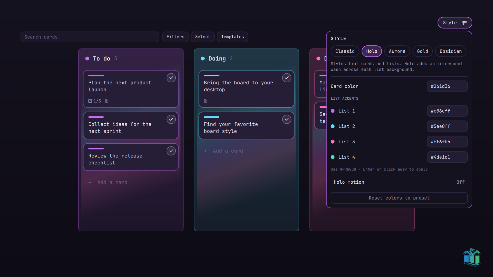
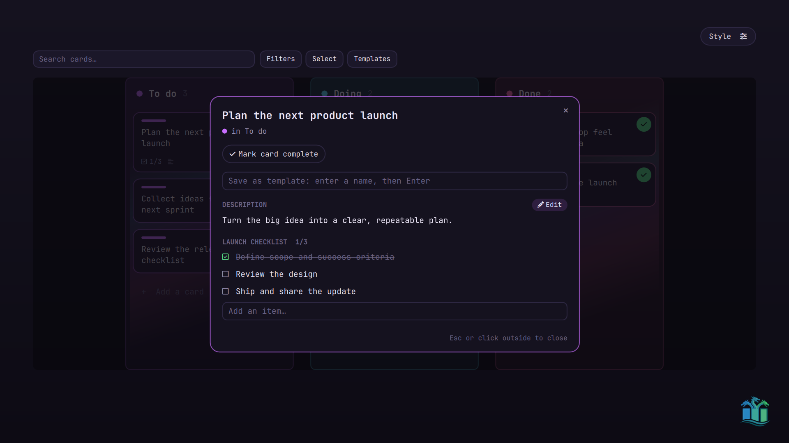
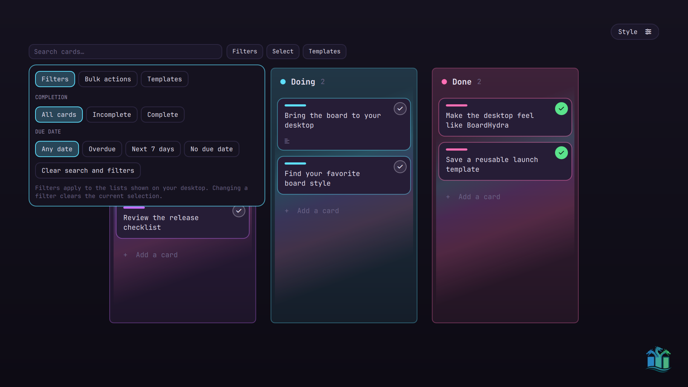
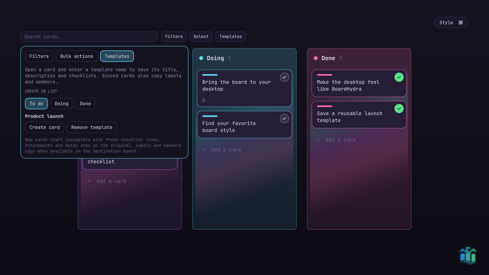
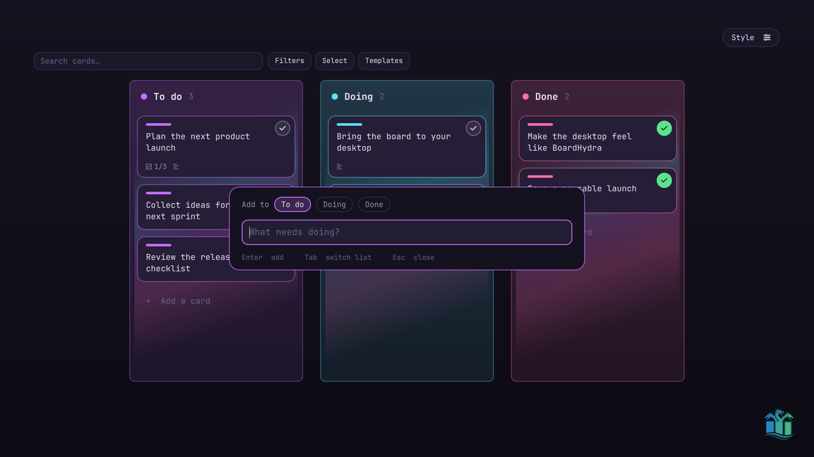

# BoardHydra Desk


An [Omarchy](https://omarchy.org/) shell plugin that draws a live kanban board on your desktop, shared across all workspaces and monitors. You can add, edit, drag, archive and delete cards right on the wallpaper. It works offline by itself, or you can sync it with a board on [BoardHydra](https://boardhydra.com).

## Screenshots

Captured with sample cards in local mode using the Holo preset.

| Appearance presets and custom colors | Card descriptions and checklists |
| --- | --- |
|  |  |
| **Search and filters** | **Reusable card templates** |
|  |  |

## Requirements

- Omarchy with the Omarchy shell
- The [BoardHydra theme](https://github.com/MadeBySaints/omarchy-boardhydra-theme), with the `2-board.png` wallpaper set. The plugin draws its own four columns over the ones painted on that wallpaper.

```bash
omarchy theme install https://github.com/MadeBySaints/omarchy-boardhydra-theme.git
# cycle to the board wallpaper if it isn't showing:
omarchy theme bg next
```

## Dependencies

- **Local mode:** none beyond the Omarchy shell.
- **Synced mode:** `curl` (API calls and the live event stream), `jq` (used only by `setup.sh`), and a [BoardHydra](https://boardhydra.com) account with an API key. Synced mode sends requests to `https://boardhydra.com` (or to `BOARDHYDRA_API_URL` if you set it when running `setup.sh`).
- **Attachment uploads:** `omarchy-file-select`, which ships with Omarchy.

All of these come with a standard Omarchy install.

## Install

```bash
omarchy plugin add https://github.com/MadeBySaints/omarchy-boardhydra-desk.git --enable
omarchy restart shell
```

> Like every Omarchy plugin, this runs unsandboxed inside `omarchy-shell`. Read the code before you install it.

## Modes

**Local (default).** You don't need an account. One board is shared across all workspaces and monitors, saved to `~/.local/share/boardhydra-desk/board.json`, in a folder only you can read (mode 700). A file from an older version at `~/.local/share/boardhydra-desk.json` is moved there automatically. When upgrading from workspace boards, the focused workspace (or workspace 1 as a fallback) is copied into the shared board once. Workspace files remain untouched; existing shared files are backed up with `-before-shared` names.

**Synced.** This connects the desktop to one of your BoardHydra boards and keeps it updated live:

```bash
~/.config/omarchy/plugins/boardhydra.desk/setup.sh
```

The script asks for an API key (BoardHydra → Settings → API keys; it starts with `bh_live_`) and lets you choose a board. It writes `~/.config/boardhydra-desk/config.json` with permissions 600. The key is passed to `curl` and `jq` on stdin, so it never appears in a process list. API calls count toward your plan's request quota. Attachment thumbnails are cached in `~/.cache/boardhydra-desk` (mode 700).

In synced mode you can open a card to edit its labels, members, due date, description, checklists and attachments. Click the board name in the top bar to open its menu:

- Pick one board to show across all workspaces and monitors. One board model and live connection serve the whole desktop.
- Choose which list fills each of the four desktop slots (1–4). Click a lit number to leave that slot empty. Picking a list that's already shown swaps the two.
- Under **Empty slots**, choose **Leave gaps** (every column stays in its slot) or **Center columns** (the shown columns close up in the middle).

Board, list, layout and appearance choices are saved in `~/.config/boardhydra-desk/state.json`. There is also a link to the full site.

## Card completion

Every card has a checkmark that turns green when complete. Click again to mark it incomplete. The open-card view also has **Mark card complete** and **Open automations** buttons. Completion works without a due date and syncs through `PATCH /api/v1/cards/:id` with `dueComplete`, matching the website. After completion, the desktop refreshes to reflect automation actions such as moving or archiving a card. Local cards also retain completion across restarts. Automations opens the website’s `/app/automation` page using the board selected in your browser.

## Appearance

Click **Style** above the lists in local or synced mode. Choose **Classic**, **Holo**, **Aurora**, **Gold**, or **Obsidian**, using BoardHydra’s special color palette. Presets style card surfaces and list backgrounds; Holo adds a moving iridescent wash behind each list’s contents.

Customize the card color and each of the four list accent colors with `#RRGGBB` values. Press Enter or click away to apply. **Reset colors to preset** clears your color overrides. **Holo motion** pauses the wash, and Omarchy’s system animation setting is respected. Appearance is shared across workspaces and applies locally, including for synced boards.

## Search, filters and bulk actions

Use the search field above the lists to match card titles and descriptions. **Filters** narrows the displayed lists by completion and due date, plus labels and assigned members in synced mode. Search and filters use loaded data without additional API requests. List headers show the matching count and total. Clear filters with **Clear** or Escape in the search field.

Click **Select**, then click cards or their checkmarks to select up to 100 cards. Click the selected count to open **Bulk actions**, or use **Select shown cards** there. Complete, reopen or move selected cards to another displayed list. Synced boards also support archiving, adding a label, and assigning a member while retaining existing labels and members. Changing a filter clears the selection.

Synced bulk actions run sequentially and display progress. Failed cards remain selected for retry; authentication and rate-limit responses stop the remaining batch. A final refresh includes website automation changes.

## Reusable card templates

Open a card, enter a name in **Save as template**, and press Enter. Open **Templates** above the lists, choose a destination list, and click **Create card**. You can also remove saved templates there.

Templates copy the title, description and checklists, plus labels and members available on the destination board. Cards and checklist items start incomplete with fresh checklist IDs; dates and attachments are omitted. Templates are private local data stored in `~/.local/share/boardhydra-desk/templates.json`, with a limit of 50. They are available across your boards. Local cards now support description and checklist editing too.

Creating a synced template card sends a create request followed by a details update. If the second request fails, the created card remains on the board and the panel reports which part failed.

## Quick-add hotkey (optional)



Quick-add opens on the focused monitor and adds to the shared board. To add a card from anywhere, put this in `~/.config/hypr/bindings.lua`:

```lua
o.bind("SUPER + ALT + B", "BoardHydra quick add", "omarchy-shell boardhydra-desk quickAdd")
```

## Update / remove

```bash
omarchy plugin update boardhydra.desk && omarchy restart shell
omarchy plugin remove boardhydra.desk
```

The desktop uses one board instance, configuration watcher and live event stream, regardless of workspace count.

Service plugins don't hot-reload, so run `omarchy restart shell` after every update.

## Validation

Run `node --test tests/*.test.mjs` to check style validation, filters and reusable template data. Run `bash tests/board.sh` from a running Omarchy desktop to check shared-board migration, completion persistence, API success and failure, automation-driven card moves, and rendering with temporary data.

Run `bash tests/tools.sh` to check local and synced filters, bulk completion/moves/labels/assignments/archiving, partial failures, rate limits, template persistence and template creation against a temporary mock API.

## License

MIT

## Storage security and validation

The plugin validates every existing ancestor of the data, configuration and
thumbnail cache directories before enabling storage. Ancestors must belong to
you or root and must not be writable by another group or user; root-owned sticky
directories such as `/tmp` are allowed. Symlink paths are rejected. Existing JSON
files must be regular files owned by you with a single hard link; they are made
private (mode 600). Directory creation, migration or permission failures leave
storage disabled.

If initialization reports unsafe storage, inspect ownership and permissions of
`~/.local/share`, `~/.config`, `~/.cache` (or `XDG_CACHE_HOME`) and their ancestors.
Use real directories with private ownership. Restart the shell after correcting
the path. The plugin does not change permissions on shared ancestors.

This prevents another local UID from replacing a private folder through a
shared ancestor after startup. Changes made later by your own UID or root are
outside this protection.

Run `node --test tests/storage.test.mjs` for storage regressions, and
`bash tests/board.sh` from an Omarchy desktop for shared-board persistence and
failure-path integration tests. Run `omarchy plugin validate .` before release.
Releases follow a branch → validation → pull request → merge → version tag and
GitHub release sequence. Publish a prepared draft only after its pull request is
merged, targeting the merged commit. Marketplace approval is a separate step:
continue a pending submission on its existing issue and edit it to rerun
validation against the new default-branch commit. Updates to an already listed
plugin use the [exact-commit verification process](https://github.com/omacom/omarchy-plugin-marketplace/blob/main/SUBMISSION.md#update-an-existing-listing).
