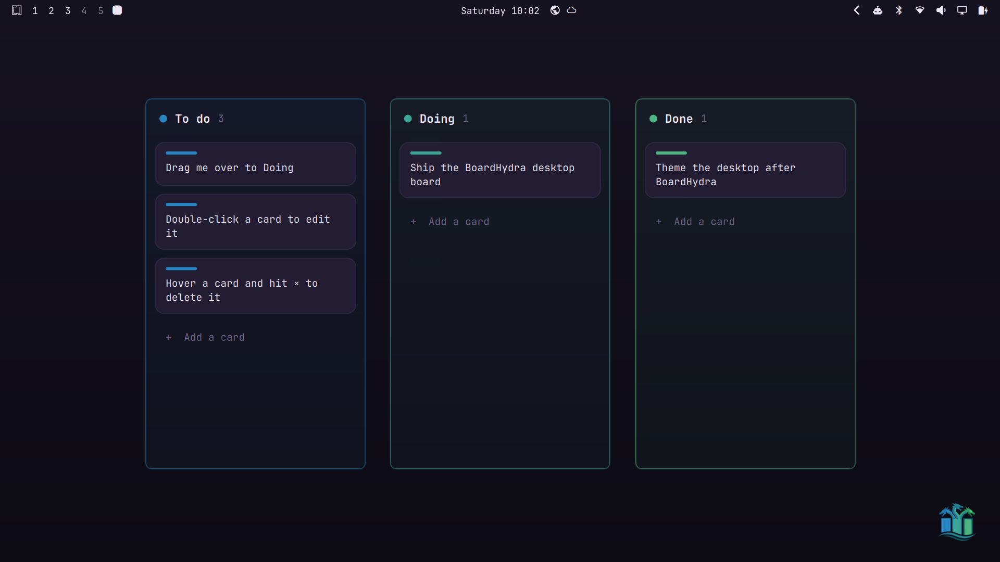

# BoardHydra Desk



An [Omarchy](https://omarchy.org/) shell plugin that draws a live kanban board on your desktop. You can add, edit, drag, archive and delete cards right on the wallpaper. It works offline by itself, or you can sync it with a board on [BoardHydra](https://boardhydra.com).

## Requirements

- Omarchy with the Omarchy shell
- The [BoardHydra theme](https://github.com/MadeBySaints/omarchy-boardhydra-theme), with the `2-board.png` wallpaper set. The plugin draws its own four columns over the ones painted on that wallpaper.

```bash
omarchy theme install https://github.com/MadeBySaints/omarchy-boardhydra-theme.git
# cycle to the board wallpaper if it isn't showing:
omarchy theme bg next
```

## Dependencies

- **Local mode:** none beyond the Omarchy shell.
- **Synced mode:** `curl` (API calls and the live event stream), `jq` (used only by `setup.sh`), and a [BoardHydra](https://boardhydra.com) account with an API key. Synced mode sends requests to `https://boardhydra.com` (or to `BOARDHYDRA_API_URL` if you set it when running `setup.sh`).
- **Attachment uploads:** `omarchy-file-select`, which ships with Omarchy.

All of these come with a standard Omarchy install.

## Install

```bash
omarchy plugin add https://github.com/MadeBySaints/omarchy-boardhydra-desk.git --enable
omarchy restart shell
```

> Like every Omarchy plugin, this runs unsandboxed inside `omarchy-shell`. Read the code before you install it.

## Modes

**Local (default).** You don't need an account. Each workspace has its own cards, saved to `~/.local/share/boardhydra-desk/workspace-<id>.json`, in a folder only you can read (mode 700). A file from an older version at `~/.local/share/boardhydra-desk.json` is moved there automatically and imported into workspace 1. Existing `board.json` cards are also imported into workspace 1.

**Synced.** This connects the desktop to one of your BoardHydra boards and keeps it updated live:

```bash
~/.config/omarchy/plugins/boardhydra.desk/setup.sh
```

The script asks for an API key (BoardHydra → Settings → API keys; it starts with `bh_live_`) and lets you choose a board. It writes `~/.config/boardhydra-desk/config.json` with permissions 600. The key is passed to `curl` and `jq` on stdin, so it never appears in a process list. API calls count toward your plan's request quota. Attachment thumbnails are cached in `~/.cache/boardhydra-desk` (mode 700).

In synced mode you can open a card to edit its labels, members, due date, description, checklists and attachments. Click the board name in the top bar to open its menu:

- Pick a board for the current workspace. Switching workspaces restores that workspace’s board; monitors can show different boards at the same time.
- Choose which list fills each of the four desktop slots (1–4). Click a lit number to leave that slot empty. Picking a list that's already shown swaps the two.
- Under **Empty slots**, choose **Leave gaps** (every column stays in its slot) or **Center columns** (the shown columns close up in the middle).

Board, list and layout choices are saved independently for each workspace in `~/.config/boardhydra-desk/workspace-<id>.json`. Existing `state.json` choices are copied as the initial defaults when a workspace is first used. There is also a link to the full site.

## Quick-add hotkey (optional)

Quick-add targets the board on the focused monitor’s active workspace. To add a card from anywhere, put this in `~/.config/hypr/bindings.lua`:

```lua
o.bind("SUPER + ALT + B", "BoardHydra quick add", "omarchy-shell boardhydra-desk quickAdd")
```

## Update / remove

```bash
omarchy plugin update boardhydra.desk && omarchy restart shell
omarchy plugin remove boardhydra.desk
```

Service plugins don't hot-reload, so run `omarchy restart shell` after every update.

## Validation

Run `bash tests/workspaces.sh` from a running Omarchy desktop to check workspace isolation, persistence, and focused-monitor quick-add routing with temporary data.

## License

MIT
